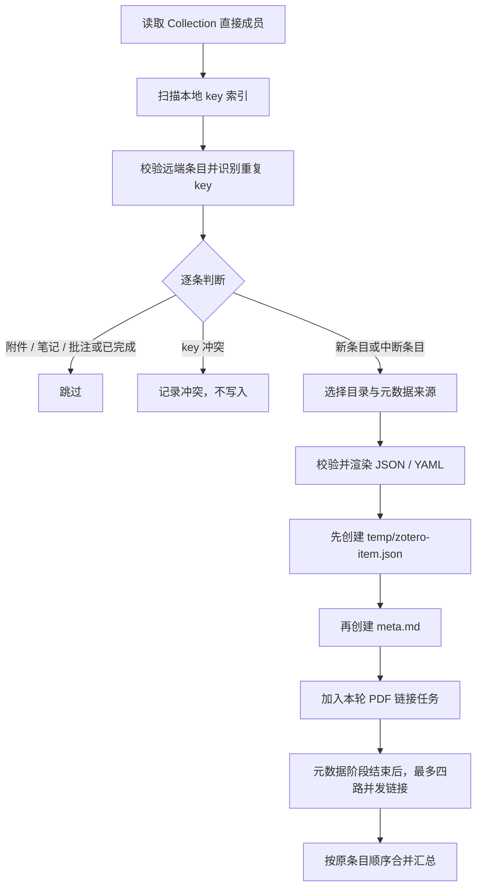
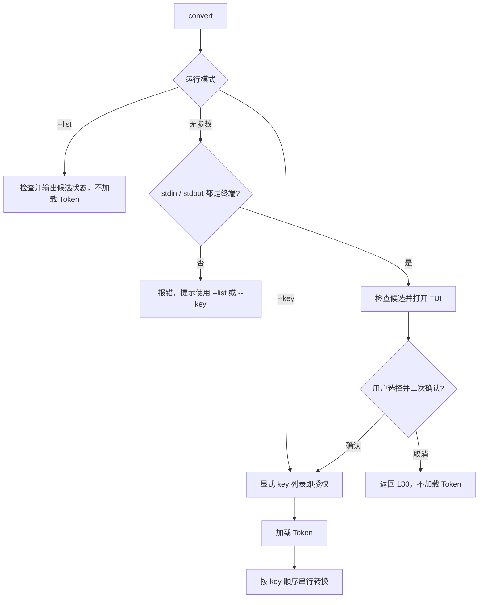

# 功能设计

本文按子命令介绍当前实现，侧重执行顺序、判断规则和失败处理。整体模块关系见 [ARCHITECTURE.md](../ARCHITECTURE.md)，命令用法见 [README.md](../README.md)。源码路径均相对 `src/paper_marrow/`。

## 1. 公共入口与约定

入口为 `cli.main`：解析参数 → 确定 vault → 加载配置 → 调用功能服务 → 输出汇总。

- `collections` 不需要 vault；`init` 未指定路径时使用当前目录。
- 其他命令优先使用显式 `--vault`，否则向上寻找最近的 `.papermarrow/config.toml`。最近配置无效时直接报错，不退回外层 vault。
- `.papermarrow/config.toml` 保存 Collection、Zotero 地址及转换默认参数；Token 独立存放。
- 本地论文以 `meta.md` 中的原生 Zotero `key` 标识，不依赖目录名或 DOI。
- 预期错误通过 `PipelineError` 传播；批处理中的条目错误进入 summary。通常成功返回 0、失败返回 1、取消或中断返回 130。

## 2. `collections`：发现 Collection

**实现：**`cli.main` → `zotero.Zotero.collections` → `listing`。

```text
--zotero-url
    ↓ 校验本机 HTTP 回环地址
GET users/0/collections（每页 100 条）
    ↓ 聚合分页
输出 key、名称、父 Collection（无父级显示 root）
```

适配器关闭代理，并发送 Zotero API 版本头。已知数据库身份后，后续请求携带 `Zotero-Server-Id`；身份变化或分页版本不一致时终止，避免混合读取。当前仅列出个人库，不支持远程 API 或团队库。

## 3. `init`：最小化初始化

**实现：**`cli.main`、`library.initialize`、`files.atomic_create`。

1. 创建 vault 目录并取得 `VaultLock`。
2. 校验 Collection key、回环 API 地址及转换参数。
3. 创建 `.papermarrow/config.toml`，已有配置则报错，绝不覆盖。

初始化不连接 Zotero、不加载 Token，也不要求 vault 为空；不生成首页、模板或论文目录。

配置校验集中在 `library.py`：拒绝未知字段，为缺少的 `[pdf2md]` 使用默认值；历史 `enabled` 字段校验后忽略，不能触发自动转换。

## 4. `doctor`：环境诊断

**实现：**`cli.doctor`。

| 检查 | 方法 | 对结果的影响 |
| --- | --- | --- |
| 配置 | 调用 `load_config` | 失败立即返回 1 |
| MinerU Token | 调用 `load_vault_token` | 缺失仅提示，不影响 sync |
| vault 可写性 | 在 vault 中创建临时文件并写入 | 失败计入诊断错误 |
| 符号链接能力 | 临时创建源文件和 PDF 链接 | 失败计入诊断错误 |
| Zotero / Collection | 读取配置指定 Collection 的条目 | 失败计入诊断错误 |

除配置错误外，各项继续检查，最后统一决定退出码。它不进行真实转换，也不完整验证硬链接发布或远程 MinerU 凭据有效性。

## 5. `sync`：一次性导入元数据

**实现：**`ingest.Importer.sync`；CLI 在整个流程外持有 `VaultLock`。



### 身份与恢复

`library.index_existing` 只检查 vault 的直接子目录，不跟随符号链接目录：

| 本地文件状态 | 索引含义 | sync 行为 |
| --- | --- | --- |
| 有 `meta.md` | complete | 跳过，不读取或补写 sidecar |
| 无 meta，有 `temp/zotero-item.json` | partial | 再次遇到该 key 时，从已有快照恢复 meta |
| 两者均无 | 未入库 | 用当前 Zotero 数据创建 |
| 多处声明同一 key | conflict | 不写该 key |
| 已有元数据格式或 key 无效 | 索引不可信 | 终止本轮，避免重复导入 |

新目录优先采用 `shortTitle`，其次 `title`，最后 key；有可用标题时附加 `[key]`，清理非法字符并截断标题。已存在的 partial 目录优先复用，因此恢复时不受 Zotero 标题变化影响。

### 数据发布

- JSON 保留完整 `item.data`；meta 使用 YAML frontmatter，仅投影 creators 与 tags，不增加 PaperMarrow 字段。
- 两份内容先完成序列化及回读校验，再写入文件。
- `atomic_create` 通过同目录临时文件、`fsync` 和硬链接实现“不存在才发布”。两份文件不是整体事务，JSON 先行提供恢复依据。
- `meta.md` 发布成功后，论文即完成入库。后续 Zotero 修改、移除或删除都不改变已有本地元数据。

PDF 链接失败不回滚入库结果。链接任务各用独立 Zotero session，主线程按原顺序合并 summary；进度通过回调写入 stderr。中断时取消尚未开始的任务，等待已运行任务结束。

## 6. `link-pdfs`：补建或修复附件链接

**实现：**`pdf_links.PdfLinker.link_existing`、`link_paper`、`ensure_pdf_link`；CLI 持有 `VaultLock`。

扫描所有已完成入库且无 key 冲突的论文，逐篇读取 Zotero children。附件需满足：父 key 匹配、内外 key 一致、属于支持的文件链接模式，并由 MIME 或扩展名识别为 PDF。

```text
PDF attachment
    ↓ /file/view/url
file: URI → 解码为绝对路径 → 验证本机普通文件
    ↓
<清理后的附件名> [ATTACHMENT_KEY].pdf → Zotero 原文件
```

链接维护以 attachment key 为身份：

| 当前状态 | 处理 |
| --- | --- |
| 无受管理链接，目标名空闲 | 创建符号链接 |
| 已有链接且名称、目标不变 | 计为 unchanged |
| 附件改名 | 先建新链接，再移除旧链接；失败时尝试撤销新链接 |
| 链接目标变化或失效 | 临时符号链接 + `os.replace` 替换旧链接 |
| 同 key 有多个链接，或目标名被其他内容占用 | 报冲突，不覆盖 |
| 无 PDF 附件 | 计为 missing，不视为失败 |
| PDF 未下载、URI 无效、创建链接失败 | 记录失败，继续其他附件 |

多个 PDF 全部链接，不推断正文；不删除 Zotero 已移除附件对应的本地链接。`sync` 复用同一链接实现，但仅处理本轮新增论文。

## 7. `convert`：显式选择并转换

**实现：**`cli.main` → `ConversionService` → `pdf2md.convert_pdf_into_paper`。

### 7.1 三种入口与授权



无候选时裸 `convert` 直接成功返回，不打开 TUI。`PickerModel` 负责排序、搜索、选择和确认；只允许选择 `Ready`，默认空选，返回界面顺序的 keys。界面退出后 CLI 才调用转换服务。

Token 优先来自真实环境变量 `MINERU_TOKEN`，其次来自 vault 的 `.papermarrow/.env`；已设置但为空的环境变量直接报错，不回退到文件。整个 convert 流程不构造 Zotero 客户端。

### 7.2 状态判定

`ConversionService.list_candidates` 从 complete 索引构建候选。key 冲突优先标记为 `Unavailable`；其余由 `inspect` 按顺序判断：

| 条件 | 状态 |
| --- | --- |
| `full.md` 是非符号链接的普通文件 | Converted |
| `full.md` 被其他类型占用，或 `images` 已存在 | Unavailable |
| `temp` 是符号链接或非目录 | Unavailable |
| 受管理 PDF 符号链接不是恰好一个，或目标失效 / 非普通文件 | Unavailable |
| 上述检查通过 | Ready |

不存在的 `temp/` 可以在转换时创建。普通 PDF 文件不参与选择；受管理链接按名称格式识别。`Ready` 是本地就绪状态，不保证后续 SDK 请求成功；输入大小等公共参数校验仍在上传前执行。

### 7.3 执行与结果发布

`convert_selected` 先校验、去重 keys，再逐篇执行：

```text
重新索引 → 检查 key 存在且无冲突
    ↓
取得单篇 PdfConversionLock → 重新 inspect
    ├─ Converted：跳过
    ├─ Unavailable：记录失败
    └─ Ready：构造 ConversionOptions
                  ↓
           校验输入和输出位置
                  ↓
           SDK extract → save_all 至隐藏暂存目录
                  ↓
           验证 full.md，拒绝符号链接 / 特殊文件
           删除顶层 PDF 副本，辅助产物归入 temp/
                  ↓
           再检查目标 → 合并不重名 temp 条目
                  ↓
           发布 images / 辅助产物 → 最后发布 full.md
```

索引期间短暂持有 vault 锁，远程请求期间只持有单篇锁；同 key 不能同时转换，不同 key 可由不同进程处理。单篇失败记录到 summary 后继续，不自动重试。

已知的输出占用在上传前阻止调用；下载后才知道的辅助文件名冲突可能已消耗额度。发布失败时尽力回滚本次产物，但不提供多文件抗崩溃事务。普通 `full.md` 是下次检查时的完成标志，不另存转换状态。

## 8. 验证入口

`tests/test_pipeline.py` 按功能组织：`ImportTests`、`PdfLinkTests`、`ConfigAndFileTests`、`ConversionServiceTests`、`Pdf2MdTests` 和 `AdapterAndCliTests`。重点覆盖不覆盖用户文件、sidecar 恢复、链接冲突、确认前无 Token / SDK 调用、转换重检查及发布回滚。

`tests/test_conversion_tui.py` 单独验证选择模型及管道输入下的交互流程。测试使用临时目录与模拟服务；真实 Zotero / MinerU 协议和目标平台文件系统行为仍需集成验证。
